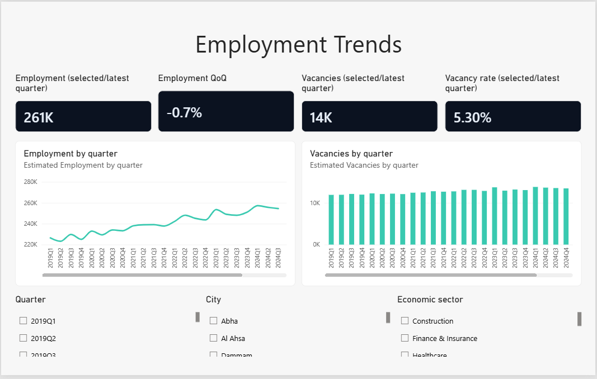
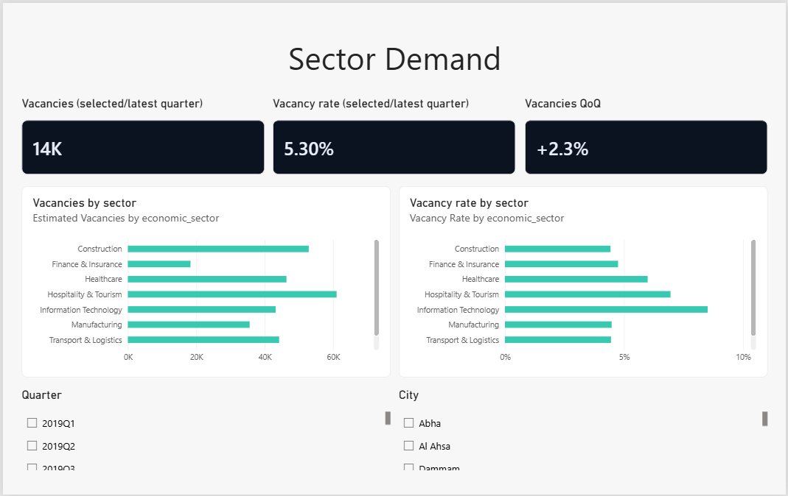
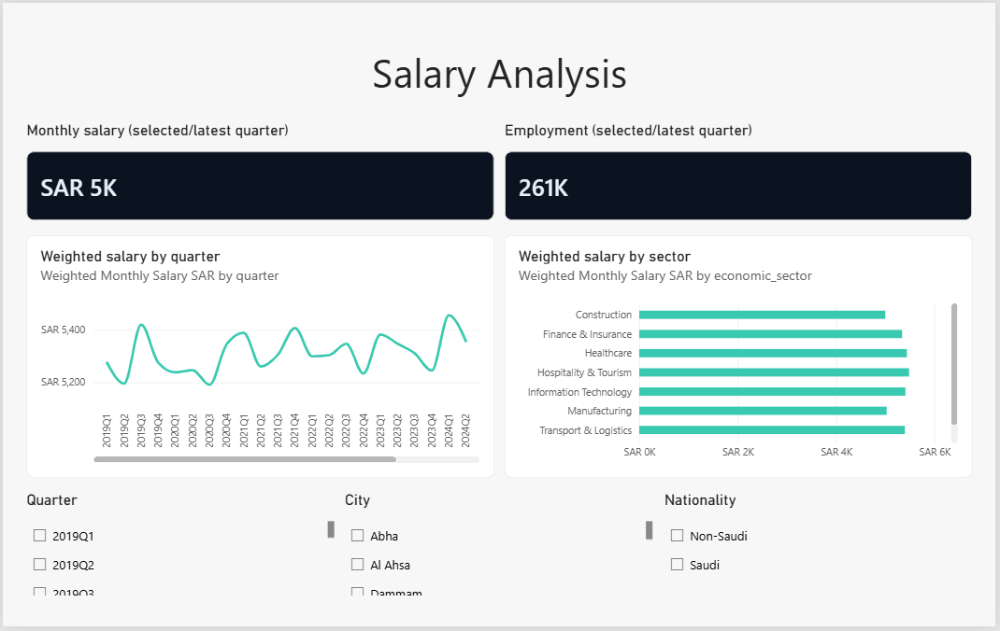
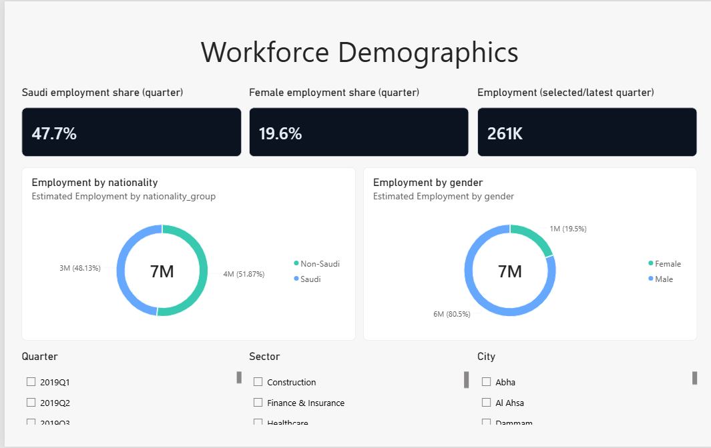

# Saudi Labor Market Analytics

**Power BI | Python | SQL | Saudi Arabia | Employment, vacancies and salaries**

I wanted to understand a simple question: **where does hiring demand look strongest when I compare vacancies with the size of the existing workforce?**

Looking only at the number of vacancies can be misleading. A large sector naturally tends to have more openings, so I built this project to compare vacancy counts, vacancy rates, employment, salaries and workforce composition in one place.

I worked with a **synthetic Saudi labor-market dataset** covering 10 cities, 8 sectors and 28 quarters (2019 Q1–2025 Q4). I used Python and SQL to explore the data and Power BI to put the results into an interactive four-page report.

> **About the data:** These are simulated estimates I used to practice market analysis. They are **not** official Saudi labor statistics, verified job vacancies, or actual salary benchmarks. The findings below describe patterns **inside this dataset**, not confirmed conditions in Saudi Arabia.

## What stood out to me

I focused on **2025 Q4** for the comparisons below so I wasn't accidentally adding together the same workforce across different quarters.

| Metric | Modeled result |
| --- | ---: |
| Estimated employment | 260,722 |
| Estimated vacancies | 13,826 |
| Vacancies as a share of employment | 5.30% |
| Employment-weighted monthly salary | SAR 5,309 |

### 1. The sector with the most vacancies isn't the sector with the highest vacancy rate

In the latest simulated quarter, **Wholesale & Retail** has the most vacancies (**2,317**), narrowly ahead of **Hospitality & Tourism** (**2,304**). But when I divide vacancies by employment, **Information Technology** comes out highest at **8.48%**, even though it has fewer vacancies (**1,574**).

That difference is the main reason I included both measures in the dashboard. **Vacancy count tells me where the volume is; vacancy rate helps me compare demand relative to sector size.** Neither measure proves that a sector is experiencing a real-world skills shortage.

### 2. Healthcare and hospitality stand out on relative demand

The modeled vacancy ratios are **6.81% for Hospitality & Tourism** and **6.31% for Healthcare**, both above the overall **5.30%**. **Manufacturing** sits lower at **4.26%**.

I would investigate whether this pattern holds in actual job-posting or official labor data before using it to make a career or recruitment decision.

### 3. Riyadh leads in volume, but city rankings change when I use a ratio

**Riyadh** has the largest modeled vacancy count (**2,458**), followed by **Khobar** (**1,892**) and **Dammam** (**1,748**). But **Madinah** has the highest vacancy-to-employment ratio among the ten modeled cities (**5.60%**), compared with **5.29% in Riyadh**.

My takeaway: **a bigger job market and a higher relative vacancy rate are not the same thing**.

### 4. Employment increased over the modeled period, but the latest quarter softened

Estimated employment goes from **226,450 in 2019 Q1** to **260,722 in 2025 Q4**, an increase of about **15.1%**. In the most recent quarter, though, employment fell about **0.7%** from 2025 Q3, while vacancies rose about **2.3%**.

I wouldn't call that a confirmed market turning point based on a synthetic series. It is a useful example of why I prefer showing both the longer-term trend and quarter-on-quarter movement.

### 5. Workforce composition needs a consistent time filter

In 2025 Q4, the dataset shows **47.7% Saudi employment** and **19.6% female employment**. One limitation in the current Power BI report is that the nationality and gender donut visuals aggregate observations across all quarters, while the headline employment KPI shows the latest quarter. **Those historical totals are not unique people or current headcounts.** I have kept this limitation visible rather than presenting the figures as directly comparable.

## The dashboard

| Page | What I wanted to see |
| --- | --- |
| **Employment Trends** | Whether employment and vacancies are moving together over time |
| **Sector Demand** | Which sectors lead by vacancy volume versus relative demand |
| **Salary Analysis** | How modeled employment-weighted salaries differ by sector and quarter |
| **Workforce Demographics** | How nationality and gender are represented in the modeled workforce |

### Screenshots

[](assets/screenshots/01_Employment_Trends.png)

[](assets/screenshots/02_Sector_Demand.png)

[](assets/screenshots/03_Salary_Analysis.png)

[](assets/screenshots/04_Workforce_Demographics.png)

## How I approached the analysis

I organized the data by quarter, city, sector, nationality and gender. For the comparisons, I used:

- **Vacancy-to-employment ratio** = vacancies ÷ employed people × 100
- **Employment-weighted salary** = sum of (salary × employed people) ÷ total employed people
- **Quarter-on-quarter change** = (current quarter − previous quarter) ÷ previous quarter × 100

I used employment-weighted averages because a simple average of sector or group salaries would give small and large workforce groups the same influence.

The repository includes the [Python analysis script](python/analyze_labor.py), [SQL queries](sql/labor_market_analysis.sql), [source dataset](data/02_labor_market_quarterly_synthetic.csv), [analysis outputs](analysis/) and editable Power BI report files.

## Open or reproduce the project

**Quickest option:** Open [`Saudi_Labor_Market.pbix`](Saudi_Labor_Market.pbix) in Power BI Desktop.

**Editable project:** Open [`Saudi_Labor_Market.pbip`](Saudi_Labor_Market.pbip), which uses the `Saudi_Labor_Market.Report/` and `Saudi_Labor_Market.SemanticModel/` folders. If Power BI asks for the data source, point it to your local copy of [the CSV](data/02_labor_market_quarterly_synthetic.csv) and refresh.

To reproduce the Python summaries and SQLite database from the repository root:

```bash
python python/analyze_labor.py
```

The script uses the Python standard library. The SQL file can be run against `analysis/labor_market.sqlite` using a SQLite client.

## What I'd do next

The first improvement I'd make is to have the demographic donut charts follow the same selected quarter as the KPI cards. After that, I'd compare these simulated patterns with real data from official Saudi sources and job-posting datasets. That would let me test which insights survive outside a portfolio exercise.

---

*Independent portfolio project. All figures and insights are based on synthetic modeled data; no affiliation with a Saudi government agency or employer is implied.*
